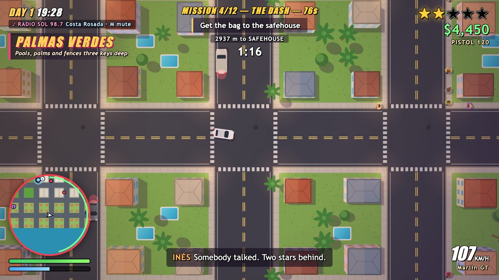

# SUNDOWN: Puerto Ámbar

An original open-world crime game for the browser: a sun-soaked coastal city to drive and walk,
cars to steal, a five-star wanted system with pursuit, ramming cruisers, cops on foot and a
helicopter, gunfights, and a twelve-mission story over three days for Inés Ocampo, Dario Kell and
Nando Reyes against the rival Teo Castellan.

## Play

    node serve.ts        # then open http://localhost:8080 in desktop Chrome

Static files only (`game/`), no build step, no network requests, no libraries.

| Keys | |
|---|---|
| W A S D | drive / walk |
| Space | handbrake drift |
| F | steal / enter / exit a car |
| Mouse | aim, click to shoot (also from the car) |
| Q | switch weapon · Shift sprint · H horn |
| Enter | take a job at a yellow marker |
| M | mute / unmute the radio |
| Esc | pause, save |

## The story

Twelve missions across three days (`game/src/missions.js`), plus replayable side jobs. The HUD
shows the mission label with its place in the list (`MISSION 4/12 — THE DASH — 50s`, counted from
the list at runtime), the objective and the distance to it, the day and clock (`DAY 1 18:24`), a
banner with a tagline on entering each of nine districts, the cast speaking in short lines, and
the radio station and track (cycling every 30 s, M mutes). From four stars a PAPD helicopter
follows with a searchlight; after 19:00 the city sinks into dusk and the streetlamps come on.

## Source

One job per file under `game/src/`. Each file opens with a `JOB:` line and an `EXPORTS:` line; the
modules under `render/` and `city/` add a `MUST NOT:` line.

| File | Job |
|---|---|
| `main.js` | boot, input, the fixed-step loop, the screen state machine |
| `config.js` | every tunable number |
| `city.js` | public entry for the city: re-exports `city/` |
| `city/blocks.js` | the seeded generation: blocks, lots, buildings, trees, coast, named places, districts |
| `city/roads.js` | the street grid: tile kinds, road and block positions, intersections, kerb points |
| `city/collide.js` | the solids hash: collision, line of sight, segment tests |
| `districts.js` | district names, taglines, the entry banner |
| `clock.js` | time of day: day start, running clock, HUD text, dusk depth |
| `render.js` | public entry for drawing: `renderFrame` runs the passes in order, re-exports `render/` |
| `render/draw.js` | primitives: shapes, shading, the baked ground chunk (roads), extruded buildings |
| `render/world.js` | the city and static scenery: chunk cache, water, boats, trees and buildings, light and dusk |
| `render/entities.js` | people, cars, the player, bullets, markers, pickups, the police helicopter |
| `render/fx.js` | particles, decals, floating text, shake: emit, age, draw |
| `camera.js` | the follow camera |
| `player.js` | walking, aiming, shooting, cars in and out, bullets |
| `vehicle.js` | car models and physics, damage, fire |
| `traffic.js` | civilian cars, pedestrians, parked cars, pickups |
| `police.js` | wanted level, pursuit, cops on foot, helicopter |
| `crew.js` | hostile gunmen on foot |
| `witnesses.js` | bystanders who phone the PAPD |
| `racing.js` | checkpoint routes and the rival driver |
| `jobs.js` | the job runner: stages, briefings, markers, pass/fail |
| `missions.js` | the twelve story missions (data) |
| `activities.js` | the three side jobs (data) |
| `story.js` | cast, days, subtitles, mission unlock order |
| `shop.js` | Punta Arms, the garage, Paint & Pray |
| `hud.js` | the HUD and minimap |
| `radio.js` | the radio station/track line |
| `audio.js` | WebAudio synthesis |
| `persist.js` | save/load |

Hand-in: `MAKEFUN_OUTPUT_DIR=out node main.ts`. Decisions are recorded in [NOTES.md](NOTES.md).
License: MIT.
