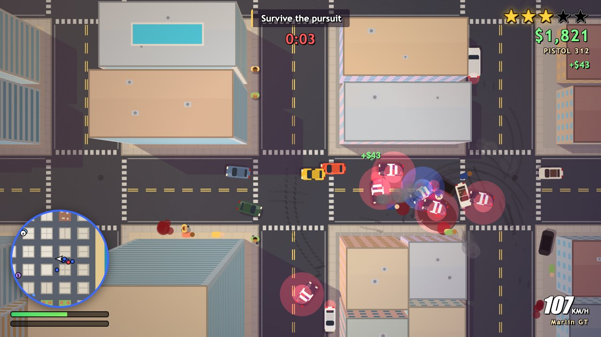

# SUNDOWN: Puerto Ámbar

An original open-world crime game for the browser: a sun-soaked coastal city to drive and walk,
cars to steal, a five-star wanted system with pursuit, ramming cruisers, cops on foot and a
helicopter, gunfights, and a three-job story for Inés Ocampo and Dario Kell.

## Play

    node serve.ts        # then open http://localhost:8080 in desktop Chrome

Static files only (`game/`), no build step, no network requests, no libraries.

| Keys | |
|---|---|
| W A S D | drive / walk |
| Space | handbrake drift |
| F | steal / enter / exit a car |
| Mouse | aim, click to shoot (also from the car) |
| Q | switch weapon · Shift sprint · H horn |
| Enter | take a job at a yellow marker |
| Esc | pause, save |

## The jobs

1. **Collection** — lift a crate from the marina under a timer, deliver it across town ($1,500).
2. **Heat** — survive 60 s at three stars, then lose them at Paint & Pray ($3,000).
3. **Score** — clear the Glasshand yard, take the stash, escape the PAPD ($8,000).

## Source

`game/src/`: `main.js` loop and state machine · `config.js` every tunable · `city.js` seeded city ·
`render.js` drawing and effects · `camera.js` · `player.js` · `vehicle.js` car physics ·
`traffic.js` cars and pedestrians · `police.js` wanted level and pursuit · `missions.js` story ·
`hud.js` HUD and minimap · `audio.js` WebAudio synthesis · `persist.js` save/load.

Hand-in: `MAKEFUN_OUTPUT_DIR=out node main.ts`. Decisions are recorded in [NOTES.md](NOTES.md).
License: MIT.
